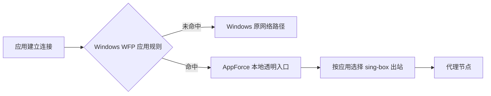

# Windows 只代理指定程序的方案调研

调研日期：2026-10-16。目标是避免未加入规则的程序因代理的数据转发路径而降速，尤其是大文件下载。本文基于微软文档、项目官方资料及部分源码检查；尚未在 Windows 真机进行吞吐、驱动共存或安装验证。

## 结论

可以让未选程序保持原来的数据传输路径。关键是**在连接建立时识别应用，只接管命中的连接**，让未命中连接继续由 Windows 正常处理。

建议优先级：

1. 目标应用确实支持完整的代理设置时，使用应用自身代理，接入 AppForce 的本地 SOCKS/HTTP 端口。
2. 需要快速验证任意 Windows 程序时，使用成熟的按程序代理工具连接本地 SOCKS/HTTP。需要核实具体工具的协议覆盖并实测未选程序的吞吐。
3. AppForce 要实现通用的按程序透明代理时，优先采用 **WFP 按应用筛选 + 本地透明转发入口 + 现有 sing-box 出站**。
4. 商业 SDK 可以减少 WFP 开发工作；目前查到的 NetFilter SDK 正式分发包仍需要集成方处理驱动签名。

工程上可以避免未选程序的数据进入代理用户态转发队列。共享网络带宽和 CPU 仍然存在，因此不应承诺在任何负载下速度绝对不变；应验证“没有额外中转”和“同条件下吞吐没有明显回退”。

## 当前实现为什么做不到这个目标

`internal/engine/config.go` 创建 TUN 时启用 `auto_route`，同时配置 IPv4、IPv6；程序规则决定代理出站，未匹配连接最终选择 `direct`。

在 Windows 上，被系统路由送入 TUN 的未选程序连接，也需要经过 AppForce 的网络栈，再由直连出站访问服务器。`direct` 表示不走代理节点，仍可能有虚拟网卡、TCP 处理、复制、排队及统计开销。

因此，以下调整只能改善具体问题，不能提供未选程序保持原路径的保证：

- 切换 gVisor、Mixed、System，调整 MTU、缓冲区或统计方式。
- 为未选程序增加一条 `direct` 规则。
- 换成同样采用全局 TUN 接管、随后按程序分流的其他代理内核。
- 仅关闭严格路由。

## 方案对比

| 方案 | 未选程序的数据是否需要进入代理用户态 | 目标应用是否需要配合 | TCP / UDP | 主要取舍 |
| --- | --- | --- | --- | --- |
| 应用自身 HTTP/SOCKS 代理 | 不需要 | 需要 | 由应用和代理协议共同决定 | 最少系统改动；必须验证主程序及联网辅助程序 |
| WFP 按应用连接重定向/过滤 | 可以不需要 | 不需要 | 可实现两者，UDP 需要独立设计 | 最符合通用按程序代理目标；需要驱动与 Windows 专用实现 |
| WFP 商业 SDK，如 NetFilter SDK | 可以通过规则只接管选中连接 | 不需要 | SDK 提供 TCP/UDP、IPv4/IPv6 能力 | 缩短驱动开发；有授权和签名成本 |
| 成熟按程序代理软件 | 依具体实现，不能仅凭产品描述保证 | 不需要 | 依产品和版本 | 最快验证体验；性能仍需实测 |
| 定向 Winsock DLL 注入，如 proxychains-windows | 未注入程序不需要 | 无需应用设置，但要能注入 | 已检查实现以 TCP 为主 | 无需自己发布内核驱动；兼容与子进程范围难处理 |
| WinDivert 自建按程序重定向 | 依过滤和进程关联设计 | 不需要 | 可处理 TCP/UDP 数据包 | 网络层没有 PID，容易退化成广泛抓包后用户态分流 |
| ProxiFyre / Windows Packet Filter | 已检查源码中，部分未选程序的出站包仍会进入用户态 | 不需要 | 项目提供 TCP/UDP、IPv4/IPv6 | 可以参考透明代理功能；不能直接满足本次路径隔离要求 |
| 把目标应用放入专用虚拟机 | 宿主机其他程序不需要 | 要改变运行环境 | 客体内可使用完整代理栈 | 隔离清楚；资源与使用成本高 |

### 应用自身代理：最适合先验证

AppForce 已有仅监听回环的本地 mixed 入站，默认地址为 `127.0.0.1:17890`。切到本地代理模式后，可以让支持代理的应用主动连接该端口，系统其他程序继续使用原网络路径。

需要验证的是应用的实际覆盖范围：

- Chromium/Electron 的代理设置，未必覆盖 Node、Go、Rust 或独立语言服务的网络请求。
- SOCKS5 支持 UDP，并不表示应用一定使用 SOCKS5 UDP；HTTP CONNECT 也不能据此宣称覆盖普通 UDP/QUIC。
- 给 IDE 设置 `HTTP_PROXY`、`HTTPS_PROXY` 等环境变量，会影响继承这些变量的终端和构建子进程。若打包程序恰好从 IDE 终端运行，这种做法可能再次扩大代理范围。

因此，Antigravity 是否能完全采用此方案仍需实测。优先使用应用明确提供的代理配置，并分别确认主程序和语言服务；不要把“启动进程及其全部后代”直接视为所选应用。

### WFP：推荐用于 AppForce 的 Windows 专用实现

微软 WFP 的 ALE connect redirection 能在应用发起连接时，把目标连接重定向到本地代理服务。WFP 提供应用标识条件 `FWPM_CONDITION_ALE_APP_ID`，可通过可执行文件路径生成。[1][2][3]

建议的数据路径：

实现应满足：

- 在 WFP 中按应用条件筛选；未选程序不进入用户态的数据转发队列。
- 不依靠修改系统默认路由、系统代理或全局 DNS 来实现按程序接管。
- 保存原目标 IP、端口和应用身份，传递给本地转发入口，维持程序节点选择及流量归属。
- 排除代理服务自身连接，处理重定向状态和上下文，避免循环；微软文档明确要求处理相关 redirect records/context。[1]
- Antigravity 只包括明确匹配的主程序和已知语言服务，不自动扩展到所有 `node.exe`、终端、打包器或全部子进程。
- 规则开关和进程重启后仍按路径生效；版本目录中的新辅助程序需要明确的规则更新机制。

**WFP 是 Windows 提供的框架，但自建连接重定向功能仍需要 callout 驱动。** 仅调用用户态防火墙规则 API，不能完成通用透明代理。微软提供 WFPSampler 的连接重定向示例，可用于学习机制，不应直接当作产品驱动发布。[1][4]

TCP 可优先用 ALE 连接重定向实现。UDP/QUIC 需要单独设计每个目的地址的映射、回包和生命周期，不能将 TCP 监听器扩展为一个 UDP 端口后就视为完成；还要验证未连接 UDP socket、多目标发送和 IPv6。微软列出支持重定向的协议，并不等于这些代理语义已经由系统自动完成。[1]

默认保留系统 DNS。Windows DNS Client 等共享服务代发查询时，原调用应用通常不能仅凭网络连接归属可靠识别；不能为解决目标应用 DNS 而把其他程序的查询整体送到代理。

对 AppForce 来说，订阅、节点、界面和 sing-box 出站可保留。需要新增 Windows 接管后端和携带原目的地/应用信息的透明入口。现有 mixed 入站要求 HTTP/SOCKS 协议握手，不能直接接收被 WFP 改写后的普通 TCP 字节流；`DialNodeContext` 目前用于账号相关的连接，也不是完整的透明入站和流量归属实现。

### 商业 WFP SDK：减少开发，不等于省掉驱动签名

NetFilter SDK 的官方文档明确说明：默认绕过数据包、不对其做数据过滤；集成方添加规则后，才接管指定网络活动。其 `NF_RULE_EX` 提供进程 ID、进程名掩码等条件，TCP/UDP 和 IPv4/IPv6 均有接口。[5][6]

这符合本次目标：只为命中的应用启用过滤，未命中连接保留系统数据路径。配置成全局 `NF_FILTER`、再在用户态排除其他程序，会失去这个优势。

需要单列的成本：

- 商业 SDK 的使用和分发授权。
- 截至本次调研，官方购买页面说明 Standard 和 Full Sources 包含的驱动二进制**未签名**，仍需集成方通过证书和微软开发者账户处理签名。[7]
- AppForce 按 GPL-3.0-or-later 分发，选定 SDK 前需要确认具体组合、源码和分发条款。

自研 WFP 和使用该 SDK 都需要制定正式驱动发布流程；SDK 主要节省驱动与协议实现工作。微软的驱动签名要求见官方文档。[8]

### 成熟软件：适合做快速对照实验

可以使用按程序代理软件，让指定应用连接 AppForce 的本地 SOCKS/HTTP，再比较打包下载速度。此时 AppForce 使用本地代理模式。

已读取的官方资料有一个容易忽略的变化：ProxyCap 官网目前推荐迁移至 NetDetour，但官方对比表中 **NetDetour 的 UDP 项为“仅阻断”，ProxyCap 为“通过 SOCKS”**。不能按“后继产品”推断两者 UDP 代理能力相同。[9]

Proxifier 也可以作为商业候选；本次其官网连接超时，未将当前版本的 UDP、驱动实现及性能声明作为已核实结论。

商业产品的成熟程度有利于快速试验，但不能单凭“按程序代理”这一功能名认定未选流量始终不经过用户态。需要做相同下载和连接覆盖的实测。

### Winsock DLL 注入：无自研驱动的另一条路

proxychains-windows 的 README 和实现说明了其方式：向指定进程注入 DLL，hook `connect`、`WSAConnect`、`ConnectEx`、DNS 相关函数，转为 SOCKS5 连接。[10]

未注入的程序可以保持原路径，适合对指定软件进行有限范围的验证。代价是不同架构、沙箱、提权进程和不同网络 API 的兼容工作。其文档仍有 UDP 相关未完成项，不能当作完整 TCP/UDP 通用方案。

特别需要处理它默认 hook `CreateProcessW` 并继续注入后代进程的行为：这可能让 IDE 内运行的打包程序也被代理。若采用注入方案，应按明确的应用路径白名单决定是否注入每个子进程。

### WinDivert：可以研究，但不是直接按 PID 改包

WinDivert 官方文档区分了不同层的能力：[11]

- `NETWORK` 层可以捕获、修改和重新注入数据包，但没有进程 ID。
- `FLOW` 层能获取进程 ID，但不能阻断或注入流事件。
- `SOCKET` 层有进程 ID、可阻断部分 socket 事件，但不能注入修改后的 socket 事件。

因此不能简单设置“NETWORK 层只抓某 PID 的包”。需要结合 socket/flow 事件或系统连接表，建立进程与连接的对应关系，再设计数据包过滤。

难点包括首包时序、端口复用、UDP 归属、多目标 socket、IPv6 和已有连接。如果实现变成广泛抓取 TCP/UDP，再由用户态判断程序并放行，仍可能影响未选程序的下载。对本项目，WFP 的连接级筛选比这条路更直接。

### ProxiFyre：功能合适，但当前数据路径不符合最强隔离目标

检查快照：`wiresock/proxifyre` 提交 `5e3bc845d73a47a0931b1233c745580cb916f4ba`。

项目提供按程序 SOCKS5、TCP/UDP、IPv4/IPv6 等能力，适合参考应用路由和 UDP 代理处理。[12]

但源码中 `socks_local_router` 安装出站包处理回调，`process_tcp_packet` 在用户态查找进程、决定是否重定向；未选连接也可能返回 `packet_action::pass`。底层 `queued_multi_interface_packet_filter` 对选中网卡设置 `MSTCP_FLAG_SENT_TUNNEL`，将这些包读入、处理并重新发送。[13][14]

它有 LAN、代理服务器等内核静态放行规则。因此这里的结论是**部分未选程序的出站包仍可能进入用户态**，不是所有包都会被截获，也不是已经证明它一定降速。它可以避免当前 TUN 的一些开销，但不能未经验证就承诺解决本次问题。

授权也应区分：此次检查的 ProxiFyre 是 AGPL-3.0；NDISAPI 库是 MIT；Windows Packet Filter 驱动是另一项依赖，不能由库的 MIT 推断驱动的分发条款。[12][15]

### 虚拟机与 Windows 企业 per-app VPN

若能把需要代理的应用整体放进 Hyper-V 等专用虚拟机，TUN 只改变客体的路由，宿主机上的打包程序继续按宿主机网络路径下载。这种隔离清楚，但会增加内存、磁盘、桌面及文件访问成本。仅安装 WSL，不能自动把宿主机 Windows 程序放入独立网络环境。

微软也提供 VPNv2 的应用触发和 per-app 流量策略。应用触发仅表示启动应用时连接 VPN，不能据此推断其他应用已经隔离；还需要配置具体 profile、路由和流量规则，并验证其 VPN 实现。[16] 这条路适合已有企业 VPN/设备管理体系的环境，不是现有本地 SOCKS 端口的直接替换。

## 建议的落地顺序与验收

**先验证收益，再确定驱动路线。**

第一步使用本地代理模式，验证应用自身代理或成熟按程序工具是否覆盖 Antigravity 主程序和语言服务，同时恢复打包下载速度。明确区分“IDE 自己联网”和“IDE 启动的构建工具联网”。

产品实现选择 WFP 后，先实现按应用的 TCP、IPv4/IPv6 连接接管，再独立补齐 UDP。Windows 新后端可以保留已有节点管理；跨平台 TUN 可继续作为另一种模式。此处是实施分期，完整交付不能把未支持的 UDP 默默当作已覆盖。

验收必须同时看数据路径和性能：

| 检查项 | 验收方式 |
| --- | --- |
| 未选程序保持原路径 | 检查系统路由、系统代理和 DNS；用连接/驱动诊断确认其载荷未进入代理转发队列 |
| 大文件下载无明显回退 | 同一资源、同一网络、缓存条件一致，多轮交替对比关闭代理、代理空闲、目标应用活跃三种状态 |
| 吞吐比较可信 | 记录实际下载速率、CPU 和失败/重传情况，以多轮波动范围判断；LAN 服务器可减少公网/CDN 的噪声 |
| 目标应用覆盖完整 | 主程序、语言服务、IPv4/IPv6、TCP/UDP 分别建立新连接核实 |
| 子进程范围准确 | 在 IDE 终端启动未加入的打包程序，确认它仍使用原路径 |
| 生命周期正确 | 验证已有下载、代理启停、规则变更、应用更新、服务异常退出、睡眠换网和 VPN 共存 |

不建议用公网单次测速或“实时连接显示直连”作为唯一验收依据；二者不能证明未选载荷绕过了代理的数据处理路径。

## AppForce 采用 WFP 的具体实施方案

### 收益与代价

| 方面 | 收益 | 代价或边界 |
| --- | --- | --- |
| 未选程序下载 | 数据保留 Windows 原路径，不经过 AppForce 转发队列 | WFP 规则匹配仍有少量系统开销；网络带宽和 CPU 仍共享 |
| 启停与换节点 | 可只处理被接管的连接，避免因改路由影响其他下载 | 已经建立的目标应用连接不会自动转为新代理连接 |
| 应用兼容 | 应用不必支持 HTTP/SOCKS，也不需要 DLL 注入 | 共享系统服务代发的请求仍不能简单归属于原应用 |
| 节点与界面 | 可复用当前订阅、协议、程序节点和流量展示 | 必须增加透明入口，保留原目的地与应用身份 |
| 开发与稳定性 | Windows 提供标准接管机制 | 新增内核驱动；错误可能影响系统稳定性，需在隔离测试机验证 |
| 安装与维护 | 可把接管做成专门的 Windows 后端 | 需要管理员安装驱动、签名发布、x64/ARM64 适配及卸载清理；需要管理已安装组件 |
| 跨平台 | Windows 可获得符合目标的数据路径 | Linux/macOS 仍需各自后端；WFP 不能直接复用到其他系统 |

### 技术选择

建议先做最小自研 callout 驱动，参考微软示例和文档，不先绑定商业 SDK。是否更换为 SDK，应由原型暴露的 UDP、兼容性或维护成本决定。

驱动仅负责连接识别、规则匹配、重定向和必要上下文。订阅解析、节点协议、加密、界面和历史统计继续放在 Go/sing-box 中，减少内核代码范围。

规则按完整应用路径匹配。当前 Go 正则不会直接下放到内核；Antigravity 的安装目录和已知语言服务范围需要转换成受限、可审查的匹配规则，避免覆盖 IDE 启动的构建工具。路径规则的更新和发布必须与连接识别配合，不能依靠容易错过首个连接的事后 PID 查询补救。

### 分阶段交付

1. **先验证 Windows 开发与发布条件。** 准备带 WDK 的 Windows 测试环境，在隔离虚拟机中加载测试驱动，确认 x64 的开发闭环；同时明确正式驱动签名所需资源。测试签名用于测试环境，普通用户发布包需要正式签名。
2. **交付一个 TCP 原型。** 实现 IPv4/IPv6 ALE 接管，只匹配一个明确路径，获取原目的地并转交本地代理服务。用同一文件下载对比代理关闭和开启时未选程序的路径、吞吐和 CPU。先证明核心目标成立，再扩展配置和界面。
3. **接入 AppForce 完整的 TCP 功能。** 增加 `wfp` 模式，分别生成出站配置和接管规则；补齐每个启用程序所需的节点。新增携带进程与原目的地的透明入口，保持程序节点选择、账号网络和流量归属。复用现有配置失败恢复机制，但仅重建有关的代理连接。驱动或模式启动失败时报告错误，由用户明确选择是否使用 TUN。
4. **补齐 UDP、QUIC 与生命周期。** 覆盖 UDP 多目标、未连接 socket、回包映射、IPv6、过期清理、规则更新及应用辅助程序更新。TCP 原型不作为“完整按程序代理”发布；界面必须准确标示当时实际支持的协议。
5. **完成发布验证。** 检查 Windows 版本、架构、防火墙/VPN 共存、睡眠换网、异常退出、安装升级和卸载。正式切换默认模式，以真机验收结果为依据。

现有配置中，`Mode == "tun"` 还控制进程规则、独立节点加载与 DNS 分支；不能简单令 WFP 复用 `mixed` 模式，否则可能丢失程序单独指定的节点。`internal/traffic/tracker.go` 已支持从连接元数据归属应用，可以由新透明入口提供可信的原进程信息后继续复用。

### 明确连接和故障行为

- 未选程序始终由系统正常处理，包括代理未运行、节点故障以及配置变更期间；不为采集它的直连统计而额外截获数据。
- 选中程序使用的节点连接失败时，请求失败，维持当前不自动回退直连的约定。
- 正常停止代理时撤销接管规则。启动前已建立的目标应用连接按原连接继续，首次接管验证使用新连接；必要时提示重新打开目标应用。
- 首版采用随服务生命周期释放的动态接管规则，服务异常退出时恢复系统路径。该选择优先恢复系统联网，意味着崩溃期间新建的目标应用连接可能直连；严格防泄漏需要另行设计阻断策略，不能默认声称已具备。
- WFP 模式仅展示实际接管的连接和流量。未选程序没有统计记录是预期行为；如需设备级统计，应采用独立的观测方案。

尚未核实本项目可用的 Windows 驱动测试机、开发者账户和签名证书。这些条件不会改变 WFP 的架构判断，但决定能否从测试原型推进到普通用户可安装的发布包。

## 资料

1. [Microsoft：Using Bind or Connect Redirection](https://learn.microsoft.com/en-us/windows-hardware/drivers/network/using-bind-or-connect-redirection)
2. [Microsoft：Filtering condition identifiers](https://learn.microsoft.com/en-us/windows/win32/fwp/filtering-condition-identifiers-)
3. [Microsoft：FwpmGetAppIdFromFileName0](https://learn.microsoft.com/en-us/windows/win32/api/fwpmu/nf-fwpmu-fwpmgetappidfromfilename0)
4. [Microsoft：WFPSampler 连接重定向示例](https://github.com/microsoft/Windows-driver-samples/blob/main/network/trans/WFPSampler/sys/ClassifyFunctions_ProxyCallouts.cpp)
5. [NetFilter SDK：Using API，默认绕过和选择性过滤](https://netfiltersdk.com/help/nfsdk_wfp/using_api.html)
6. [NetFilter SDK：NF_RULE_EX](https://netfiltersdk.com/help/nfsdk_wfp/ref_NF_RULE_EX.html)
7. [NetFilter SDK：购买、授权及驱动签名说明](https://netfiltersdk.com/buy_now.html)
8. [Microsoft：Driver Signing Policy](https://learn.microsoft.com/en-us/windows-hardware/drivers/install/kernel-mode-code-signing-policy--windows-vista-and-later-)
9. [NetDetour：ProxyCap 迁移与功能对比](https://www.netdetour.com/pcap/)
10. [proxychains-windows：机制和已知限制](https://github.com/shunf4/proxychains-windows)
11. [WinDivert：各层能力，2.2 文档](https://github.com/basil00/WinDivert/blob/97101072dbe31d744ca3429da389350a3df39e18/doc/windivert.html)
12. [ProxiFyre：功能、限制和许可证](https://github.com/wiresock/proxifyre/blob/5e3bc845d73a47a0931b1233c745580cb916f4ba/README.md)
13. [ProxiFyre：socks_local_router.h](https://github.com/wiresock/proxifyre/blob/5e3bc845d73a47a0931b1233c745580cb916f4ba/netlib/src/proxy/socks_local_router.h)
14. [ProxiFyre：queued_multi_interface_packet_filter.h](https://github.com/wiresock/proxifyre/blob/5e3bc845d73a47a0931b1233c745580cb916f4ba/netlib/src/ndisapi/queued_multi_interface_packet_filter.h)
15. [NDISAPI：MIT 许可证及驱动关联](https://github.com/wiresock/ndisapi)
16. [Microsoft：VPN auto-triggered profile options](https://learn.microsoft.com/en-us/windows/security/operating-system-security/network-security/vpn/vpn-auto-trigger-profile)；[VPNv2 CSP](https://learn.microsoft.com/en-us/windows/client-management/mdm/vpnv2-csp)
